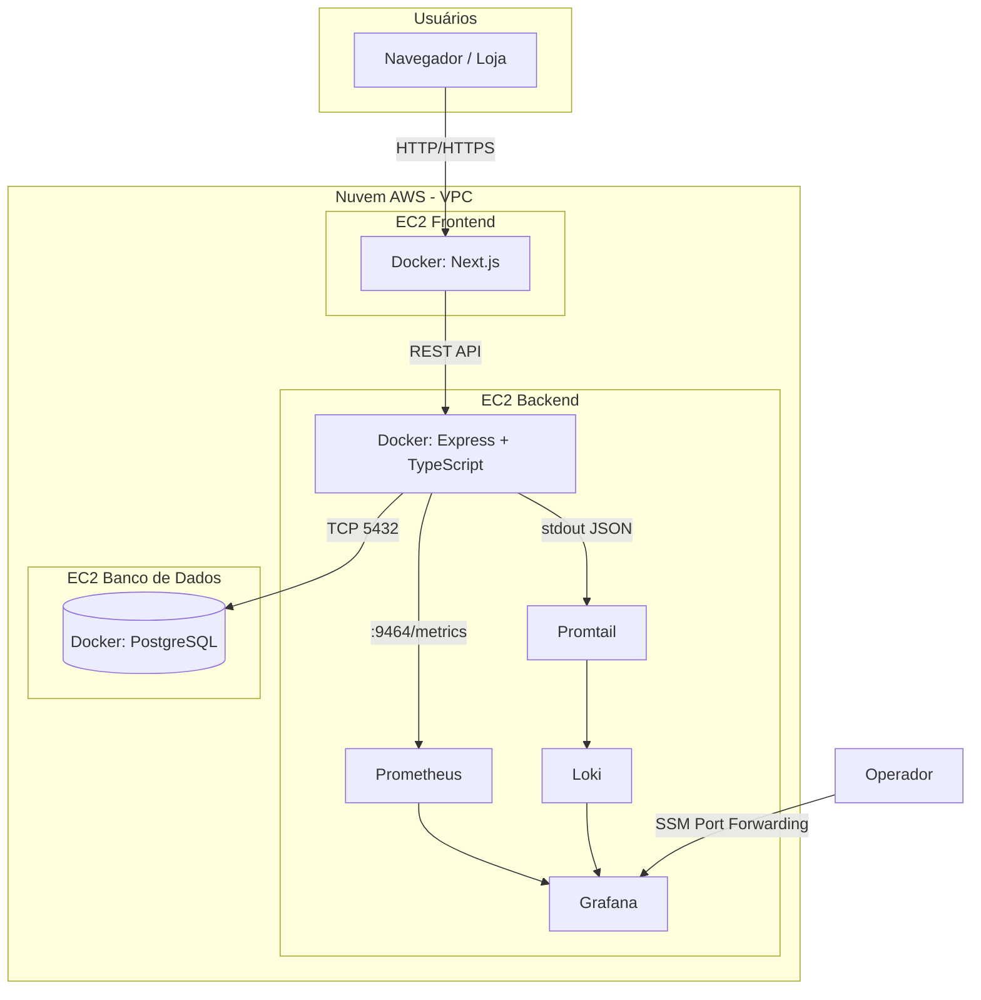

# Arquitetura da Solução

Este documento descreve a visão geral da arquitetura de software e infraestrutura do projeto **CloudOps Lab**.

---

## 1. Visão Geral do Sistema

A aplicação é uma plataforma de **cadastro de clientes para uma loja de roupas**, composta pelos seguintes componentes centrais executados em contêineres **Docker** em instâncias **Amazon EC2** separadas:
- **Frontend (UI):** Aplicação **Next.js** em uma EC2 dedicada, oferecendo a interface web para cadastro, busca e gerenciamento de clientes.
- **Backend (API / Serviços):** API REST em **Express + TypeScript** em uma EC2 dedicada, responsável pelas regras de negócio, validações e exposição de métricas.
- **Persistência de Dados:** Banco de dados **PostgreSQL** em uma EC2 dedicada, com volume persistente para armazenamento durável dos dados dos clientes.
- **Observabilidade:** Prometheus, Grafana, Loki e Promtail executados na EC2 do backend, com métricas internas na porta `9464`, logs JSON e dashboards centralizados.
- **Serviços de Nuvem & Infraestrutura:** Recursos de computação (3 EC2), rede (VPC, Subnets e Security Groups) e registro de imagens (ECR) provisionados via Terraform.

---

## 2. Diagrama de Arquitetura

O fluxo fundamental de comunicação entre os componentes:

---

## 3. Componentes e Responsabilidades

| Componente | Tecnologia | Hospedagem | Responsabilidade |
| :--- | :--- | :--- | :--- |
| **Frontend** | Next.js + Docker | EC2 dedicada (Frontend) | Interface visual de cadastro, listagem e edição de clientes da loja. |
| **Backend** | Express + TypeScript + Docker | EC2 dedicada (Backend) | Endpoints REST/API, regras de negócio, validações e métricas. |
| **Persistência** | PostgreSQL + Docker | EC2 dedicada (Banco de Dados) | Armazenamento relacional e transacional dos cadastros de clientes. |
| **Observabilidade** | Prometheus + Grafana + Loki + Promtail + Docker | EC2 do backend | Métricas, logs e dashboards; acesso administrativo somente por SSM. |
| **Infraestrutura** | Terraform + AWS (EC2, VPC, ECR) | AWS | Provisionamento automatizado das 3 instâncias EC2, rede e segurança. |

---

## 4. Decisões Arquiteturais (ADRs)

Para consultar as justificativas técnicas formais de cada escolha tecnológica, acesse:
👉 [**Registros de Decisões de Arquitetura (ADRs)**](adrs/)

