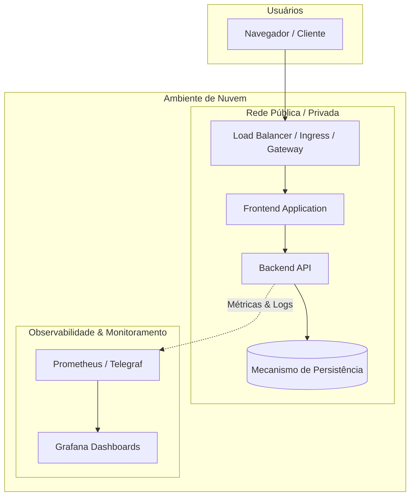

# Arquitetura da Solução

Este documento descreve a visão geral da arquitetura de software e infraestrutura do projeto **CloudOps Lab**.

---

## 1. Visão Geral do Sistema

A aplicação é composta pelos seguintes componentes centrais:
- **Frontend (UI):** Interface de usuário para interação com os clientes.
- **Backend (API / Serviços):** Regras de negócio, processamento de requisições e integração.
- **Persistência de Dados:** Banco de dados relacional ou não-relacional para armazenamento durável de informações.
- **Serviços de Nuvem & Infraestrutura:** Recursos de computação, rede e gerenciamento provisionados via Terraform.

---

## 2. Diagrama de Arquitetura

O fluxo fundamental de comunicação entre os componentes:

---

## 3. Componentes e Responsabilidades

| Componente | Tecnologia Prevista | Responsabilidade |
| :--- | :--- | :--- |
| **Frontend** | *A definir* | Interface visual, renderização de páginas e interação do usuário. |
| **Backend** | *A definir* | Endpoints REST/API, lógica de negócio, autenticação e validações. |
| **Persistência** | *A definir (ex: PostgreSQL/MongoDB)* | Armazenamento persistente e transacional dos dados. |
| **Infraestrutura** | Terraform + Cloud Provider | Provisionamento automatizado e gerenciamento de estado. |

---

## 4. Decisões Arquiteturais (ADRs)

Para consultar as justificativas técnicas formais de cada escolha tecnológica, acesse:
👉 [**Registros de Decisões de Arquitetura (ADRs)**](file:///home/matias/Documentos/cloudops-lab/docs/arquitetura/adrs/)

