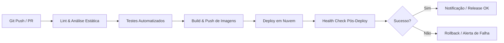

# Integração e Entrega Contínuas (CI/CD)

Este documento descreve a estratégia, arquitetura e estágios do pipeline de CI/CD do projeto **CloudOps Lab**.

---

## 1. Objetivos do Pipeline

O pipeline automatizado foi estruturado para cumprir integralmente os requisitos de automação e qualidade:
1. **Verificação de Código e Testes Automatizados:** Linting, testes unitários e de integração executados a cada *commit* ou *Pull Request*.
2. **Construção de Artefatos:** Build de imagens Docker ou pacotes de distribuição e publicação em registry.
3. **Implantação Automatizada (Continuous Deployment):** Atualização do ambiente de nuvem de forma declarativa e automatizada.
4. **Verificação Automatizada Pós-Deploy (Smoke Tests / Health Check):** Verificação ativa da disponibilidade e integridade da aplicação logo após a implantação.

---

## 2. Visão Geral do Fluxo

---

## 3. Estágios do Pipeline

### 3.1. Stage 1: Quality & Test (CI — *Quality Gate*)
- **Linter & Formatação:** Validação de sintaxe e padrões de código (backend e frontend).
- **Testes Unitários:** Execução de testes de unidade com relatório de cobertura.
- **Testes de Integração / API:** Execução de testes de comunicação com banco de dados e endpoints.
- **Influência dos Testes na Implantação (Bloqueio Automático):** Os estágios seguintes (`Build` e `Deploy`) dependem estritamente do sucesso desta etapa (`needs: test`). Caso o linter ou qualquer teste automatizado falhe, **o pipeline é interrompido imediatamente**, impedindo a geração de artefatos e bloqueando a implantação na AWS.

### 3.2. Stage 2: Build & Package
- **Criação de Artefatos:** Construção de imagens de contêiner otimizadas (multi-stage build com Docker).
- **Tagging:** Versionamento baseado em SHA do commit ou tag semântica de release.
- **Registry:** Envio seguro para o **Amazon ECR** (ou registry equivalente configurado).

### 3.3. Stage 3: Deploy (CD — AWS)
- Disparo automatizado via **GitHub Actions** para o ambiente **AWS** (atualização dos contêineres nas EC2 via SSM Run Command).
- Aplicação das atualizações de infraestrutura/serviço com zero ou mínimo *downtime*.
- Após o backend e o frontend, a stack de observabilidade (Prometheus, Grafana, Loki e Promtail) é enviada e iniciada na EC2 do backend.
- Os segredos da aplicação são lidos do **SSM Parameter Store** dentro das instâncias; o Infisical não participa do runtime de produção nesta fase.

### 3.4. Stage 4: Verificação Pós-Deploy (Smoke Testing)
- Execução de requisição automatizada (ex: script curl, teste E2E ou ferramenta de teste de API) contra o endpoint de `/health` ou funcionalidade principal.
- Critério de falha: se a aplicação retornar código diferente de `200 OK` ou tempo de resposta excessivo, o pipeline falha e alerta a equipe.

---

## 4. Gerenciamento de Segredos no Pipeline

A estratégia é híbrida e separada por ambiente, conforme a [ADR 006](../arquitetura/adrs/006-estrategia-hibrida-de-segredos.md):

- **CI:** os segredos do ambiente `dev` são obtidos do **Infisical** pelo `Infisical/secrets-action`, usando **OIDC Auth** com uma Machine Identity. Apenas variáveis não sensíveis (`INFISICAL_IDENTITY_ID` e `INFISICAL_PROJECT_SLUG`) são armazenadas como *Variables* do repositório. O passo roda apenas em `push` para `main`/`develop`; em PRs os testes usam o fallback de ambiente de teste.
- **CD:** as credenciais temporárias da AWS (`AWS_ACCESS_KEY_ID`, `AWS_SECRET_ACCESS_KEY`, `AWS_SESSION_TOKEN`) ficam em GitHub Secrets, exigência do AWS Academy Learner Lab. Os segredos da aplicação em produção ficam no **SSM Parameter Store** e são lidos pelas EC2 durante o deploy (`infra/deploy/criar-segredos.sh` e `implantar-*.sh`). A senha do Grafana também é lida do SSM (`/cloudops-lab/senha-grafana`) por `implantar-monitoramento.sh`.
- Nenhum segredo da aplicação é exposto nos logs de execução do pipeline; o job de CI valida apenas a presença das variáveis (`test -n`).

