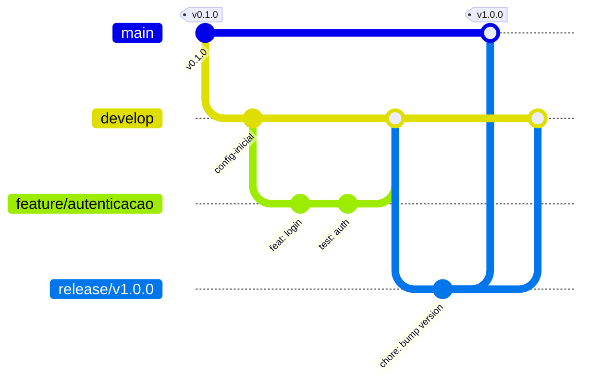

# Padrões de Código, Nomenclatura e Git (GitFlow & Conventional Commits)

Este documento define os padrões obrigatórios de desenvolvimento para o projeto **CloudOps Lab**, abrangendo idioma de código, nomenclatura, fluxo de branches com GitFlow e mensagens de commit semântico (Conventional Commits) em **pt-BR**.

---

## 1. Padrão de Idioma para Código (pt-BR)

### 1.1. Regra Geral
Para assegurar a legibilidade e consistência do projeto, o idioma padrão para a escrita de:
- **Nomes de arquivos e pastas**
- **Nomes de funções e métodos**
- **Nomes de variáveis, constantes e classes**
- **Comentários de código e documentação interna**

é o **Português do Brasil (pt-BR)**.

### 1.2. Exceção para Termos Convencionados em Inglês
Termos técnicos consolidados e convencionados internacionalmente no ecossistema de desenvolvimento, nuvem e DevOps **não** devem ser traduzidos.

**Lista exemplificativa de termos aceitos em inglês:**
- Ações e fluxos: *deploy, build, teardown, setup, healthcheck, run, lint, debug, test, release, rollback*.
- Componentes e protocolos: *backend, frontend, middleware, token, id, payload, request, response, status, body, headers, cookie, session, database, cluster, cache, queue*.
- Nomes de ferramentas e arquivos de configuração padrão: *Dockerfile, docker-compose.yml, package.json, Makefile, main.tf*.

### 1.3. Exemplos Práticos de Nomenclatura

#### ✅ Correto (pt-BR com termos técnicos aceitos):
```typescript
// Nome de arquivo: usuarios.servico.ts

interface DadosUsuario {
  id: string;               // 'id' convencionado
  nomeCompleto: string;
  email: string;
  papel: string;
}

class ServicoUsuarios {
  private statusConexao: boolean = true;

  async buscarUsuarioPorId(id: string): Promise<DadosUsuario | null> {
    const usuarioEncontrado = await this.repositorio.obterPorId(id);
    return usuarioEncontrado;
  }

  async processarPayload(payload: any): Promise<void> {
    // payload e status aceitos como termo técnico
    const tokenAcesso = await gerarToken(payload);
    await enviarNotificacao(tokenAcesso);
  }
}
```

```python
# Nome de arquivo: monitoramento_metricas.py

def coletar_metricas_requisicao(tempo_resposta_ms, status_code):
    """Registra metricas coletadas para envio ao Prometheus."""
    if status_code >= 400:
        registrar_erro(status_code, tempo_resposta_ms)
```

#### ❌ Incorreto:
```typescript
// Não usar nomes inteiramente em inglês para regras de negócio:
class UserService {
  getUserById() { ... }
}

// Nem forçar traduções absurdas para termos técnicos consagrados:
function verificarSaudeAplicacao() { ... } // Prefira healthcheck()
const cargaUtil = request.body;           // Prefira payload ou dadosRequisicao
```

---

## 2. Estratégia de Branches: GitFlow

Adotamos o fluxo **GitFlow** para gerenciar o ciclo de vida do código:



### 2.1. Branches Principais
- **`main`:** Contém o código pronto para produção, estável e testado. Toda versão em `main` deve possuir uma tag de versão (`vX.Y.Z`).
- **`develop`:** Branch base de integração contínua. É a partir de `develop` que novas branches de funcionalidade são criadas e para onde retornam.

### 2.2. Branches de Suporte
- **`feature/<nome-funcionalidade>`:**
  - Origem: `develop` | Destino: `develop`
  - Nomenclatura em pt-BR e *kebab-case*.
  - Exemplo: `feature/autenticacao-jwt`, `feature/painel-metricas`, `feature/cadastro-produtos`.
- **`release/<versao>`:**
  - Origem: `develop` | Destino: `main` e `develop`
  - Usada para ajustes finais de documentação, versão e estabilização antes de ir para produção.
  - Exemplo: `release/v1.0.0`.
- **`hotfix/<nome-correcao>`:**
  - Origem: `main` | Destino: `main` e `develop`
  - Usada para correções críticas imediatas em ambiente de produção.
  - Exemplo: `hotfix/correcao-conexao-banco`, `hotfix/falha-token-jwt`.

---

## 3. Padrão de Commits: Conventional Commits em pt-BR

Todas as mensagens de commit devem seguir a especificação **Conventional Commits**, redigidas obrigatoriamente em **Português do Brasil**.

### 3.1. Estrutura do Commit
```text
<tipo>(<escopo opcional>): <descrição no imperativo/presente em pt-BR>

[corpo explicativo opcional em pt-BR detalhando o contexto e motivação]

[rodapé opcional para referências de tarefas ou breaking changes]
```

### 3.2. Tipos de Commits e Exemplos

| Tipo | Finalidade | Exemplo em pt-BR |
| :--- | :--- | :--- |
| `feat` | Nova funcionalidade implementada. | `feat(auth): adiciona geracao de token jwt no login` |
| `fix` | Correção de defeito/bug. | `fix(banco): resolve problema de timeout no pool de conexoes` |
| `docs` | Alterações e inclusões na documentação. | `docs(readme): atualiza instrucoes de desenvolvimento local` |
| `infra` | Alterações de infraestrutura (Terraform, Cloud). | `infra(terraform): cria configuracao da vpc e subnets` |
| `ci` | Modificações em scripts e pipelines de automação. | `ci(github-actions): adiciona verificacao pos-deploy de healthcheck` |
| `test` | Inclusão ou ajuste de suítes de teste. | `test(usuarios): cria testes unitarios para criacao de conta` |
| `refactor` | Refatoração de código sem alterar o comportamento externo. | `refactor(rotas): reorganiza controladores de api em modulos` |
| `perf` | Melhorias de desempenho e latência. | `perf(produtos): adiciona indice na coluna de busca` |
| `chore` | Tarefas auxiliares, dependências ou ferramentas de build. | `chore(deps): atualiza versoes de bibliotecas do frontend` |

### 3.3. Boas Práticas para a Mensagem
- Use letras minúsculas no início da descrição.
- Não termine a descrição com ponto final (`.`).
- Seja objetivo e explique o *porquê* da mudança quando houver complexidade no corpo do commit.

---

## 4. Commits Incrementais e Atômicos (Narrativa do Fluxo)

> [!IMPORTANT]
> **Proibidos Commits Monolíticos:** Nunca agrupe alterações de banco, regras de negócio, interface, infraestrutura e testes em um único "megacommit" (ex: `feat: finaliza feature inteira`).

Os commits devem ser **estritamente atômicos e incrementais**, separados por funcionalidade ou estágio de desenvolvimento, para que o histórico do Git conte uma história clara do fluxo de trabalho.

### 4.1. Por que Commits Incrementais?
1. **Rastreabilidade e Clareza:** Facilita a revisão de código (*code review*) e a compreensão da evolução lógica da solução.
2. **Reversibilidade Segura:** Se um bug for introduzido, é possível reverter apenas o commit pontual com `git revert` sem descartar o restante do trabalho.
3. **Bisect e Depuração:** Permite usar `git bisect` de forma eficaz para encontrar a linha exata onde uma regressão começou.
4. **Isolamento de Responsabilidade:** Cada commit compila, faz sentido por si só e foca em uma única responsabilidade.

### 4.2. Exemplo Prático de Fluxo Incremental

Ao desenvolver uma funcionalidade (ex: criação do fluxo de autenticação na branch `feature/autenticacao-jwt`), divida o trabalho em etapas lógicas sequenciais:

```bash
# 1. Configuração de esquema / modelo de persistência
git commit -m "feat(modelo): define entidade e esquema de credenciais no banco"

# 2. Camada de acesso a dados / repositório
git commit -m "feat(repositorio): cria metodos para busca e armazenamento de credenciais"

# 3. Lógica de negócio / serviços
git commit -m "feat(servico): implementa geracao de token jwt e hashing de senha"

# 4. Exposição de endpoints / rotas
git commit -m "feat(controlador): cria rota post /login e middleware de autenticacao"

# 5. Validação e testes automatizados
git commit -m "test(auth): adiciona testes unitarios e de integracao para o login"

# 6. Documentação técnica
git commit -m "docs(auth): documenta payload de login e variaveis de ambiente"
```

### 4.3. Regra de Separação de Contextos
Se durante o desenvolvimento de uma funcionalidade você precisar:
- Corrigir um bug não relacionado: faça em um commit separado (`fix(...)`).
- Atualizar dependências ou formatação: faça em um commit separado (`chore(...)` ou `style(...)`).
- Ajustar arquivos de infraestrutura ou CI: faça em um commit separado (`infra(...)` ou `ci(...)`).

