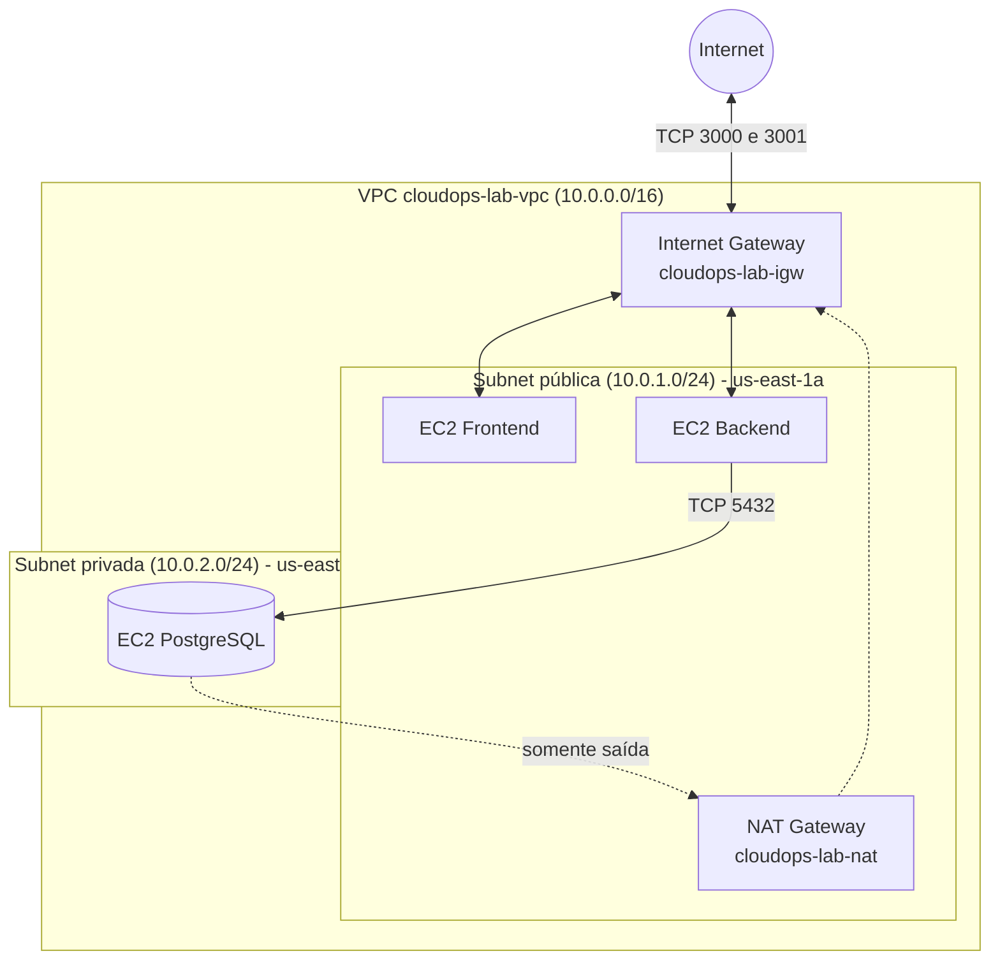

# Infraestrutura como Código (Terraform)

Este documento descreve a infraestrutura em nuvem do projeto **CloudOps Lab**, provisionada e gerenciada via **Terraform** no diretório [`infra/`](../../infra/).

---

## 1. Visão Geral

A infraestrutura é declarada em código (IaC) e versionada no Git. O ambiente de nuvem utilizado é o **AWS Academy Learner Lab**, na região `us-east-1`.

| Camada | Recursos | Situação |
| :--- | :--- | :--- |
| **Rede** | VPC, subnet pública, subnet privada, Internet Gateway e tabelas de rotas | Implementado |
| **Saída da subnet privada** | Elastic IP e NAT Gateway | Implementado |
| **Segurança** | Security Groups do frontend, backend e banco de dados | Implementado |
| **Computação** | 3 instâncias EC2 com Docker (frontend, backend e PostgreSQL) | Pendente |
| **Registro de imagens** | ECR | Pendente |
| **Persistência** | Volume EBS da EC2 do PostgreSQL | Pendente |

Decisões relacionadas:
- Topologia de rede: [ADR 004](../arquitetura/adrs/004-topologia-de-rede-vpc-unica.md).
- Acesso administrativo e deploy via SSM, sem SSH: [ADR 005](../arquitetura/adrs/005-acesso-administrativo-via-ssm.md).

---

## 2. Topologia de Rede



> [!NOTE]
> As instâncias EC2 aparecem no diagrama para indicar onde serão posicionadas, mas ainda não estão implementadas.

### 2.1. Recursos de Rede Provisionados

| Recurso Terraform | Nome (tag `Name`) | Configuração |
| :--- | :--- | :--- |
| `aws_vpc.principal` | `cloudops-lab-vpc` | CIDR `10.0.0.0/16`, DNS hostnames habilitado |
| `aws_subnet.publica` | `cloudops-lab-subnet-publica` | CIDR `10.0.1.0/24`, `us-east-1a`, IP público automático |
| `aws_subnet.privada` | `cloudops-lab-subnet-privada` | CIDR `10.0.2.0/24`, `us-east-1a`, sem IP público |
| `aws_internet_gateway.principal` | `cloudops-lab-igw` | Anexado à VPC |
| `aws_route_table.publica` | `cloudops-lab-rt-publica` | Rota `0.0.0.0/0` para o Internet Gateway |
| `aws_route_table_association.publica` | - | Associa a subnet pública à tabela de rotas pública |
| `aws_eip.nat` | `cloudops-lab-eip-nat` | IP público fixo usado pelo NAT Gateway |
| `aws_nat_gateway.principal` | `cloudops-lab-nat` | Fica na subnet pública e usa o Elastic IP |
| `aws_route_table.privada` | `cloudops-lab-rt-privada` | Rota `0.0.0.0/0` para o NAT Gateway |
| `aws_route_table_association.privada` | - | Associa a subnet privada à tabela de rotas privada |

### 2.2. Tabelas de Rotas

**Tabela pública** (`cloudops-lab-rt-publica`), associada à subnet pública:

| Destino | Alvo |
| :--- | :--- |
| `10.0.0.0/16` | `local` |
| `0.0.0.0/0` | Internet Gateway |

**Tabela privada** (`cloudops-lab-rt-privada`), associada à subnet privada:

| Destino | Alvo |
| :--- | :--- |
| `10.0.0.0/16` | `local` |
| `0.0.0.0/0` | NAT Gateway |

O NAT Gateway fica na subnet **pública**, pois precisa da rota para o Internet Gateway. Ele permite que a EC2 do PostgreSQL inicie conexões de saída (download de imagens e pacotes e registro no SSM), mas não aceita conexões iniciadas pela internet.

> [!WARNING]
> O NAT Gateway e o Elastic IP têm custo por hora e, no Learner Lab, **continuam ativos após o fim da sessão**. Destrua-os ao final de cada dia de trabalho, conforme a [remoção parcial do NAT](teardown.md#5-remoção-parcial-somente-o-nat-gateway).

### 2.3. Security Groups

Definidos em [`infra/seguranca.tf`](../../infra/seguranca.tf). As regras usam os recursos `aws_vpc_security_group_ingress_rule` e `aws_vpc_security_group_egress_rule`, separados do grupo.

| Security Group | Entrada | Origem | Motivo |
| :--- | :--- | :--- | :--- |
| `cloudops-lab-sg-frontend` | TCP 3000 | `0.0.0.0/0` | Acesso dos usuários ao Next.js |
| `cloudops-lab-sg-backend` | TCP 3001 | `0.0.0.0/0` | O navegador chama a API diretamente (`NEXT_PUBLIC_API_URL`) |
| `cloudops-lab-sg-banco` | TCP 5432 | `cloudops-lab-sg-backend` | Somente o backend acessa o PostgreSQL |

- **Saída:** os três grupos liberam todo o tráfego de saída (`0.0.0.0/0`), necessário para baixar imagens, pacotes e para o agente do SSM. O Terraform não cria a regra de saída padrão da AWS, por isso ela é declarada explicitamente.
- **Sem porta 22:** nenhuma instância aceita SSH. O acesso administrativo e o deploy são feitos pelo SSM Session Manager ([ADR 005](../arquitetura/adrs/005-acesso-administrativo-via-ssm.md)).
- **Descrições:** as descrições dos grupos e das regras não aceitam acentos. Alterar a descrição de um grupo faz o Terraform destruí-lo e recriá-lo.

### 2.4. Tags

Todos os recursos recebem automaticamente as tags abaixo, definidas em `default_tags` no provider:

| Tag | Valor |
| :--- | :--- |
| `Projeto` | Valor da variável `projeto` |
| `GerenciadoPor` | `terraform` |

---

## 3. Pré-requisitos

- **Terraform CLI** `>= 1.5.0`
- **AWS CLI v2**
- Acesso ao **AWS Academy Learner Lab** da disciplina

No Windows, as duas ferramentas podem ser instaladas com o `winget`:

```powershell
winget install Hashicorp.Terraform
winget install Amazon.AWSCLI
```

Após a instalação, feche e abra novamente o terminal (ou o editor) para que o `PATH` seja atualizado.

---

## 4. Configuração das Credenciais (Learner Lab)

O Terraform lê as credenciais da AWS a partir dos arquivos de configuração do AWS CLI, localizados **fora do repositório**.

> [!CAUTION]
> Nunca copie as credenciais para arquivos dentro do repositório, para a documentação ou para mensagens. Os valores abaixo são placeholders.

1. Inicie o Learner Lab (**Start Lab**) e aguarde o indicador **AWS** ficar verde.
2. Clique em **AWS Details** e, ao lado de **AWS CLI**, clique em **Show**.
3. Copie o bloco exibido para o arquivo `~/.aws/credentials` (no Windows: `C:\Users\<USUARIO>\.aws\credentials`, sem extensão):

   ```ini
   [default]
   aws_access_key_id=<AWS_ACCESS_KEY_ID>
   aws_secret_access_key=<AWS_SECRET_ACCESS_KEY>
   aws_session_token=<AWS_SESSION_TOKEN>
   ```

4. Crie o arquivo `~/.aws/config` com a região (apenas uma vez):

   ```ini
   [default]
   region = us-east-1
   ```

5. Valide o acesso:

   ```bash
   aws sts get-caller-identity
   ```

   O campo `Arn` deve conter `voclabs`.

> [!IMPORTANT]
> As credenciais do Learner Lab são temporárias e mudam a cada sessão. Erros como `ExpiredToken` ou `InvalidClientTokenId` indicam que é preciso repetir os passos 1 a 3.

### 4.1. Restrições do Learner Lab

- Não é possível criar roles ou usuários IAM. Para instâncias EC2, utiliza-se o perfil existente `LabInstanceProfile`.
- O `LabInstanceProfile` permite o acesso pelo SSM Session Manager (testado em 2026-11-22). Por isso o par de chaves SSH `vockey` não é utilizado.
- O crédito do laboratório é limitado. Recursos com custo por hora (EC2, NAT Gateway, Elastic IP) devem ser destruídos após o uso.

---

## 5. Estrutura de Diretórios

```text
infra/
├── terraform.tf         # Versão mínima do Terraform e do provider AWS
├── variables.tf         # Variáveis de entrada
├── main.tf              # Provider, rede e NAT Gateway
├── seguranca.tf         # Security Groups e regras
└── .terraform.lock.hcl  # Versões travadas dos providers (versionado)
```

Arquivos gerados localmente e **não versionados** (ignorados pelo `.gitignore`): `.terraform/`, `terraform.tfstate`, `terraform.tfstate.backup`, `tfplan` e `*.tfvars`.

---

## 6. Variáveis

| Variável | Descrição | Padrão |
| :--- | :--- | :--- |
| `regiao` | Região AWS onde os recursos são criados. | `us-east-1` |
| `projeto` | Nome do projeto, usado como prefixo nos nomes e nas tags dos recursos. | `cloudops-lab` |

---

## 7. Ciclo de Vida e Comandos

Todos os comandos são executados dentro de `infra/`:

```bash
cd infra/
```

### 7.1. Inicialização
Baixa o provider AWS na versão travada pelo `.terraform.lock.hcl`:
```bash
terraform init
```

### 7.2. Formatação e Validação
Padroniza a formatação e verifica a sintaxe, sem acessar a AWS:
```bash
terraform fmt
terraform validate
```

### 7.3. Planejamento
Consulta a AWS e exibe o que será criado, alterado ou destruído, sem aplicar nada:
```bash
terraform plan -out=tfplan
```

Antes de aplicar, confira o resumo `Plan: X to add, Y to change, Z to destroy`. Um `destroy` inesperado indica problema.

### 7.4. Aplicação
Aplica exatamente o plano revisado:
```bash
terraform apply tfplan
```

### 7.5. State
O state (`terraform.tfstate`) é mantido **localmente** na máquina de quem executa o `apply`. Por isso, apenas uma pessoa deve aplicar e destruir o ambiente por vez. A adoção de backend remoto (S3) está em aberto.

---

## 8. Destruição e Remoção de Recursos (Teardown)

> [!WARNING]
> Para evitar consumo do crédito do Learner Lab e manter o ambiente limpo após testes e avaliações, é **obrigatório** seguir o procedimento de remoção:
> 👉 [**Guia de Destruição de Recursos (Teardown)**](teardown.md)
