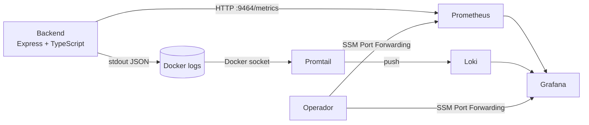

# Observabilidade e Telemetria

Este documento descreve a solução de observabilidade implementada no **CloudOps Lab**, os acessos, as métricas, os logs e os dashboards.

A decisão está registrada na [ADR 003](../arquitetura/adrs/003-estrategia-de-observabilidade.md).

---

## 1. Visão Geral

A stack roda na **mesma EC2 do backend**, sem nova instância, Security Group ou volume:



| Componente | Porta | Exposição |
| :--- | :--- | :--- |
| Backend | `3001` | Pública, API |
| Métricas do backend | `9464` | Pública apenas na EC2; não é aberta no Security Group |
| Prometheus | `9090` | `127.0.0.1` na EC2 |
| Grafana | `3002` | `127.0.0.1` na EC2 |
| Loki | `3100` | Somente rede interna do Docker |
| Promtail | `9080` | Somente rede interna do Docker |

A EC2 do backend usa `t3.small` para acomodar a API e a stack. O Prometheus retém até 24 horas ou 128 MB; o Loki retém 24 horas. Os logs Docker têm rotação de `10 MB` por arquivo e três arquivos.

---

## 2. Métricas

O backend expõe métricas no formato Prometheus em `http://localhost:9464/metrics` dentro da EC2. O endpoint **não** é exposto na porta pública `3001`.

| Métrica | Tipo | Uso |
| :--- | :--- | :--- |
| `http_requests_total` | Counter | Requisições por método, rota e status |
| `http_request_duration_seconds` | Histogram | Tempo de resposta e cálculo de p95/p99 |
| `http_requests_in_flight` | Gauge | Requisições simultâneas |
| `app_up` | Gauge | Disponibilidade da aplicação (`1`/`0`) |
| `db_connection_status` | Gauge | Conexão com o PostgreSQL (`1`/`0`) |

O Prometheus coleta as métricas a cada 15 segundos. Em desenvolvimento local, o alvo é `host.docker.internal:9464`; o `docker-compose.yml` da raiz publica essa porta.

---

## 3. Logs

O backend grava logs JSON no `stdout`. O Promtail coleta os logs dos contêineres `backend` (produção) e `cloudops-backend` (local), extrai os rótulos `level` e `service` e envia ao Loki.

Exemplo:

```json
{
  "timestamp": "2026-11-24T19:30:00.000Z",
  "level": "ERROR",
  "service": "backend",
  "message": "erro_na_requisicao",
  "requestId": "9f1c...",
  "method": "GET",
  "path": "/clientes",
  "status": 500,
  "durationMs": 42,
  "error": "Connection timeout"
}
```

No Grafana, use **Explore → Loki** para consultar:

```logql
{container=~"backend|cloudops-backend"} | json | level =~ "ERROR|WARN"
```

---

## 4. Dashboards

O dashboard **CloudOps Lab - Visão Geral** é provisionado automaticamente e contém:

- disponibilidade do backend (`up`);
- requisições por segundo;
- latência p95;
- status da conexão com o banco;
- requisições por status HTTP;
- latência p95 e p99 ao longo do tempo;
- logs de erro/aviso;
- logs recentes do backend.

Prometheus e Grafana usam volumes Docker para persistir os dados entre reinícios dos contêineres.

---

## 5. Acesso em Produção (SSM Port Forwarding)

Nenhuma porta administrativa é aberta na internet. Use o SSM Session Manager com o plugin do AWS CLI instalado.

No **Git Bash** do Windows, evite a conversão de caminhos:

```bash
export MSYS_NO_PATHCONV=1
export AWS_REGION=us-east-1
ID_BACKEND=$(aws ec2 describe-instances \
  --filters "Name=tag:Name,Values=cloudops-lab-backend" "Name=instance-state-name,Values=running" \
  --query 'Reservations[0].Instances[0].InstanceId' --output text)

aws ssm start-session --target "$ID_BACKEND" \
  --document-name AWS-StartPortForwardingSession \
  --parameters '{"portNumber":["3002"],"localPortNumber":["3002"]}'
```

Com a sessão aberta, acesse `http://localhost:3002`. Usuário: `admin`. Senha: parâmetro `/cloudops-lab/senha-grafana` no SSM.

Para o Prometheus, repita o comando trocando as portas para `9090`. O Loki não precisa de porta local: consulte-o pelo **Grafana Explore**.

Para obter a senha do Grafana:

```bash
aws ssm get-parameter --name /cloudops-lab/senha-grafana --with-decryption \
  --query Parameter.Value --output text
```

---

## 6. Deploy

O workflow de CD envia `infra/observabilidade/` para a EC2 do backend e executa `infra/deploy/implantar-monitoramento.sh`. O script:

1. lê a senha do Grafana no SSM;
2. sobe a stack com `docker compose up -d`;
3. valida Prometheus, Grafana e Loki.

O backend é publicado com `METRICS_PORT=9464`, `LOG_LEVEL=info` e rotação de logs. A stack é recriada a cada deploy, mas os volumes de dados são mantidos.

---

## 7. Validação e Diagnóstico

Na EC2 do backend, pelo SSM Session Manager:

```bash
cd /opt/observabilidade
docker compose ps
docker compose logs --tail 100 prometheus
docker compose logs --tail 100 grafana
docker compose logs --tail 100 loki
docker compose logs --tail 100 promtail
curl -fsS http://localhost:9464/metrics | head
curl -fsS http://localhost:9090/-/healthy
curl -fsS http://localhost:3002/api/health
```

Se o dashboard não mostrar logs, confirme no Grafana **Explore** que o seletor `{container=~"backend|cloudops-backend"}` retorna dados e verifique se o contêiner do backend está gerando logs JSON.

---

## 8. Limitações Conhecidas

- A stack compartilha a EC2 do backend: se a instância falhar, a API e a observabilidade ficam indisponíveis.
- Não há alta disponibilidade nem backup dos dados de métricas/logs; a retenção é de 24 horas.
- O frontend e o PostgreSQL não enviam logs ao Loki nesta versão; o escopo mínimo cobre a API.
- O acesso ao Grafana e ao Prometheus depende do SSM Port Forwarding.
