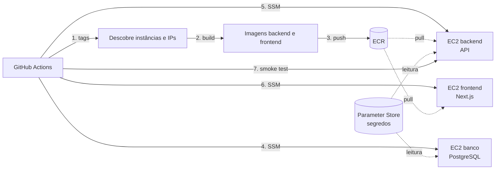

# Guia de Implantação (Deploy) em Nuvem

Este guia descreve como a aplicação é implantada nas instâncias EC2 criadas pelo Terraform, de forma automatizada pelo GitHub Actions ou manualmente pelo terminal, e o que precisa ser renovado a cada sessão do AWS Academy Learner Lab.

---

## 1. Visão Geral

O deploy é feito pelo workflow [`.github/workflows/cd.yml`](../../.github/workflows/cd.yml), que usa os scripts de [`infra/deploy/`](../../infra/deploy/). Nenhuma instância aceita SSH: os comandos são executados pelo **SSM Run Command** ([ADR 005](../arquitetura/adrs/005-acesso-administrativo-via-ssm.md)).



| Etapa | Script | O que faz |
| :--- | :--- | :--- |
| 1 | [`descobrir-infra.sh`](../../infra/deploy/descobrir-infra.sh) | Encontra as instâncias e os Elastic IPs pelas tags `Name`, sem depender do state do Terraform. Liga as instâncias paradas. |
| 2 e 3 | `cd.yml` | Gera as imagens com a tag do commit e `latest` e envia ao ECR. O frontend é gerado com o endereço do backend em `NEXT_PUBLIC_API_URL`. |
| 4 | [`implantar-banco.sh`](../../infra/deploy/implantar-banco.sh) | Sobe o PostgreSQL com os dados em `/dados/postgres` (volume EBS) e cria as tabelas do [`init.sql`](../../database/init.sql) na primeira execução. |
| 5 | [`implantar-backend.sh`](../../infra/deploy/implantar-backend.sh) | Baixa a imagem do ECR, lê os segredos e sobe a API na porta 3001. |
| 6 | [`implantar-frontend.sh`](../../infra/deploy/implantar-frontend.sh) | Baixa a imagem do ECR e sobe o Next.js na porta 3000. |
| 7 | [`smoke-test.sh`](../../infra/deploy/smoke-test.sh) | Verifica, de fora da AWS, o `/health` do backend e a página do frontend. |

Os scripts das etapas 4 a 6 são enviados às instâncias pelo [`executar-remoto.sh`](../../infra/deploy/executar-remoto.sh), que aguarda o agente do SSM ficar online, executa o script e exibe a saída.

Scripts auxiliares, executados manualmente:

| Script | Quando usar |
| :--- | :--- |
| [`criar-segredos.sh`](../../infra/deploy/criar-segredos.sh) | Uma vez por conta AWS, para criar os segredos da aplicação (seção 3.2) |
| [`atualizar-credenciais-github.sh`](../../infra/deploy/atualizar-credenciais-github.sh) | Opcional, a cada sessão, para atualizar os segredos do GitHub (seção 4.2) |

---

## 2. Ambiente Oficial

Cada Learner Lab é uma **conta AWS separada**. O código não depende de nenhuma conta específica: IPs, ids e o endereço do ECR são descobertos na conta em que o deploy roda.

**As credenciais cadastradas nos segredos do GitHub definem para qual conta o deploy vai.** Trocar os segredos muda o ambiente de destino, sem alterar o código.

| Fase | Learner Lab | Responsável pelo Terraform e pelos segredos do GitHub |
| :--- | :--- | :--- |
| Testes do pipeline | Jeane Vitoria | Jeane Vitoria |
| Ambiente oficial | Brenno Araujo (maior crédito disponível) | Brenno Araujo |

### 2.1. Troca do Ambiente para Outro Learner Lab

1. No novo laboratório, configure as credenciais locais ([guia de infraestrutura, seção 4](../infraestrutura/README.md#4-configuração-das-credenciais-learner-lab)) e execute `terraform init` e `terraform apply` em `infra/`. O state fica na máquina de quem executa.
2. Crie os segredos da aplicação na nova conta (seção 3.2).
3. Substitua os três segredos do GitHub pelas credenciais do novo laboratório (seção 4.2).
4. No laboratório anterior, execute o `terraform destroy` completo, conforme o [teardown](../infraestrutura/teardown.md), para não consumir mais crédito.

> [!WARNING]
> Apenas o responsável pelo ambiente oficial deve alterar os segredos do GitHub. Caso contrário, o deploy automático passa a ir para outra conta sem que o grupo perceba.

---

## 3. Pré-requisitos (Uma Única Vez por Conta)

### 3.1. Infraestrutura
A infraestrutura deve estar criada com `terraform apply`, conforme o [guia de infraestrutura](../infraestrutura/README.md). O NAT Gateway precisa existir no momento do deploy: sem ele, a EC2 do banco não baixa a imagem do PostgreSQL nem responde pelo SSM.

### 3.2. Segredos da Aplicação (Parameter Store)
Os segredos da aplicação ficam no **SSM Parameter Store**, criptografados (`SecureString`). As instâncias os leem diretamente da AWS durante o deploy, usando a permissão do `LabInstanceProfile`. Eles não passam pelo GitHub, pelo código nem pelos logs.

| Parâmetro | Tipo | Uso |
| :--- | :--- | :--- |
| `/cloudops-lab/senha-banco` | `SecureString` | Senha do usuário `cloudops_user` do PostgreSQL |
| `/cloudops-lab/jwt-access-secret` | `SecureString` | Assinatura dos tokens de acesso (`JWT_ACCESS_SECRET`) |
| `/cloudops-lab/jwt-refresh-secret` | `SecureString` | Assinatura dos tokens de renovação (`JWT_REFRESH_SECRET`) |
| `/cloudops-lab/senha-admin` | `SecureString` | Senha do administrador inicial (`ADMIN_PASSWORD`) |
| `/cloudops-lab/email-admin` | `String` | E-mail do administrador inicial (`ADMIN_EMAIL`) |

Para criá-los, execute uma vez no **Git Bash**, na raiz do repositório, com as credenciais locais válidas:

```bash
bash infra/deploy/criar-segredos.sh            # e-mail do admin: admin@loja.com
bash infra/deploy/criar-segredos.sh meu@email  # ou informe outro e-mail
```

O script gera valores aleatórios e **não altera segredos que já existem**. Isso é obrigatório para a senha do banco: o PostgreSQL a grava na primeira inicialização, e uma senha diferente depois impediria o backend de conectar.

Para consultar a senha do administrador, necessária para entrar no painel:

```bash
export MSYS_NO_PATHCONV=1   # somente no Git Bash do Windows
aws ssm get-parameter --name /cloudops-lab/senha-admin --with-decryption \
  --query Parameter.Value --output text
```

Também é possível consultá-la no console, em **Systems Manager → Parameter Store**.

> [!NOTE]
> Os parâmetros não são criados pelo Terraform, para que os valores não fiquem gravados no `terraform.tfstate`. Por isso, o `terraform destroy` não os remove.

---

## 4. A Cada Sessão do Learner Lab

As credenciais do Learner Lab são **temporárias**. Cada nova sessão gera credenciais novas e cancela as anteriores (pela política `voc-cancel-cred`). Por isso, elas precisam ser renovadas em todos os lugares onde estão cadastradas.

### 4.1. O Que Atualizar

| Atividade na sessão | O que atualizar |
| :--- | :--- |
| Executar Terraform ou scripts no próprio computador | Arquivo `~/.aws/credentials` ([guia de infraestrutura, seção 4](../infraestrutura/README.md#4-configuração-das-credenciais-learner-lab)) |
| Executar o deploy pelo GitHub Actions | Os três segredos do GitHub (seção 4.2) |
| As duas coisas | Os dois |

Não é necessário atualizar os segredos do GitHub em sessões em que nenhum deploy será executado.

### 4.2. Atualizar os Segredos do GitHub

Há duas formas equivalentes. Use a que preferir.

#### Pela interface do GitHub

1. No Learner Lab, clique em **Start Lab** e aguarde o indicador **AWS** ficar verde.
2. Clique em **AWS Details** e, ao lado de **AWS CLI**, clique em **Show**.
3. No GitHub, abra **Settings → Secrets and variables → Actions**.
4. Para cada segredo abaixo, clique no nome do segredo (ou em **New repository secret**, na primeira vez), cole **somente o valor** e salve:

| Segredo no GitHub | Valor no Learner Lab |
| :--- | :--- |
| `AWS_ACCESS_KEY_ID` | Valor após `aws_access_key_id=` |
| `AWS_SECRET_ACCESS_KEY` | Valor após `aws_secret_access_key=` |
| `AWS_SESSION_TOKEN` | Valor após `aws_session_token=` |

> [!CAUTION]
> Cole apenas o valor, sem o nome, sem o `=` e sem espaços ou quebras de linha no final. Nunca cole as credenciais em arquivos do repositório, em issues ou em mensagens.

#### Opcional: pelo GitHub CLI

O script [`atualizar-credenciais-github.sh`](../../infra/deploy/atualizar-credenciais-github.sh) lê o arquivo `~/.aws/credentials` e atualiza os três segredos de uma vez, sem exibir os valores. Ele testa as credenciais antes de enviá-las, para não gravar no GitHub credenciais vencidas ou incompletas.

**Uma única vez por pessoa**, instale o GitHub CLI e faça login com uma conta que tenha permissão para alterar os segredos do repositório:

```powershell
winget install GitHub.cli
```

Feche e abra novamente o terminal (ou o editor) e execute:

```bash
gh auth login
```

Responda **GitHub.com**, **HTTPS** e **Login with a web browser**, copie o código exibido e autorize no navegador. Para conferir:

```bash
gh auth status
```

**A cada sessão**, atualize o arquivo `~/.aws/credentials` ([guia de infraestrutura, seção 4](../infraestrutura/README.md#4-configuração-das-credenciais-learner-lab)) e execute no **Git Bash**, na raiz do repositório:

```bash
bash infra/deploy/atualizar-credenciais-github.sh
```

Saída esperada:

```text
Credenciais validas: arn:aws:sts::<ID_DA_CONTA>:assumed-role/voclabs/<USUARIO>
✓ Set Actions secret AWS_ACCESS_KEY_ID for <DONO>/cloudops-lab
Atualizado: AWS_ACCESS_KEY_ID
✓ Set Actions secret AWS_SECRET_ACCESS_KEY for <DONO>/cloudops-lab
Atualizado: AWS_SECRET_ACCESS_KEY
✓ Set Actions secret AWS_SESSION_TOKEN for <DONO>/cloudops-lab
Atualizado: AWS_SESSION_TOKEN
Segredos do GitHub atualizados.
```

Se os segredos estiverem desatualizados, o workflow falha na etapa **Configurar credenciais da AWS** ou **Descobrir infraestrutura**, com erros como `ExpiredToken`, `InvalidClientTokenId` ou `UnauthorizedOperation` citando `voc-cancel-cred`.

### 4.3. Por Que Não É Possível Evitar

Em uma conta AWS comum, o GitHub Actions obteria credenciais temporárias automaticamente por **OIDC**, sem segredos cadastrados. Isso exige criar uma role no IAM, o que o Learner Lab não permite. Por isso, as credenciais temporárias precisam ser copiadas manualmente a cada sessão.

---

## 5. Deploy Automatizado (GitHub Actions)

O workflow `CD - Deploy na AWS` é executado:
- automaticamente, quando o workflow de CI termina com sucesso na branch `main`;
- manualmente, na aba **Actions → CD - Deploy na AWS → Run workflow**.

> [!NOTE]
> O GitHub só exibe e executa workflows que existem na branch padrão do repositório. Até o `cd.yml` estar na `main`, o deploy deve ser feito manualmente (seção 6).

Dois deploys nunca rodam ao mesmo tempo (`concurrency: deploy-aws`). As imagens recebem a tag com os 12 primeiros caracteres do hash do commit, o que permite identificar a versão em execução em cada instância.

---

## 6. Deploy Manual (Contingência)

Os mesmos scripts do workflow podem ser executados no **Git Bash**, na raiz do repositório, com as credenciais locais válidas e o **Docker Desktop** aberto:

```bash
export AWS_REGION=us-east-1 PROJETO=cloudops-lab MSYS_NO_PATHCONV=1

# 1. Descobre instâncias, IPs e o registro ECR (define id_banco, url_api etc.)
eval "$(bash infra/deploy/descobrir-infra.sh)"
TAG=$(git rev-parse --short=12 HEAD)

# 2. Login no ECR
aws ecr get-login-password --region "$AWS_REGION" | docker login --username AWS --password-stdin "$registro"

# 3. Build e push das imagens
docker build -t "$registro/$PROJETO-backend:$TAG" ./backend
docker push "$registro/$PROJETO-backend:$TAG"
docker build --build-arg NEXT_PUBLIC_API_URL="$url_api" -t "$registro/$PROJETO-frontend:$TAG" ./frontend
docker push "$registro/$PROJETO-frontend:$TAG"

# 4. Deploy nas instâncias, nesta ordem
bash infra/deploy/executar-remoto.sh "$id_banco" infra/deploy/implantar-banco.sh \
  AWS_REGION="$AWS_REGION" PROJETO="$PROJETO" INIT_SQL_B64="$(base64 -w0 database/init.sql)"
bash infra/deploy/executar-remoto.sh "$id_backend" infra/deploy/implantar-backend.sh \
  AWS_REGION="$AWS_REGION" PROJETO="$PROJETO" IMAGEM="$registro/$PROJETO-backend:$TAG" \
  IP_BANCO="$ip_banco" URL_FRONTEND="$url_frontend"
bash infra/deploy/executar-remoto.sh "$id_frontend" infra/deploy/implantar-frontend.sh \
  AWS_REGION="$AWS_REGION" IMAGEM="$registro/$PROJETO-frontend:$TAG"

# 5. Smoke test
bash infra/deploy/smoke-test.sh "$url_api" "$url_frontend"
```

> [!IMPORTANT]
> Não passe segredos como `VAR=valor` para o `executar-remoto.sh`: esses valores ficam visíveis no histórico do SSM Run Command. Segredos devem ser lidos do Parameter Store dentro dos scripts.

---

## 7. Validação Pós-Deploy (Smoke Test)

O [`smoke-test.sh`](../../infra/deploy/smoke-test.sh) é a última etapa do workflow e falha o deploy se:

- o `/health` do backend não responder HTTP 200 em até 2 minutos. Esse endpoint só responde 200 quando a API consegue se conectar ao PostgreSQL, então valida backend e banco juntos;
- a página do frontend não responder HTTP 200.

Para executá-lo manualmente, use as URLs exibidas por `terraform output`:

```bash
bash infra/deploy/smoke-test.sh http://<IP_BACKEND>:3001 http://<IP_FRONTEND>:3000
```

---

## 8. Problemas Conhecidos

| Problema | Impacto | Responsável |
| :--- | :--- | :--- |
| O cookie de renovação do login usa `secure: true` e `sameSite: 'strict'` em produção, mas o ambiente não tem HTTPS e o frontend e o backend estão em endereços diferentes | O login inicial funciona, mas a sessão não é renovada após o token de acesso expirar (15 minutos) | Aplicação (Lucas Matias) |
| O `/metrics` é exposto na mesma porta pública da API (3001) | Métricas internas acessíveis por qualquer pessoa na internet | Observabilidade (Brenno Araujo) |
| O tráfego usa HTTP, sem TLS | Senha de login e tokens trafegam sem criptografia | Segurança (Brenno Araujo) |
