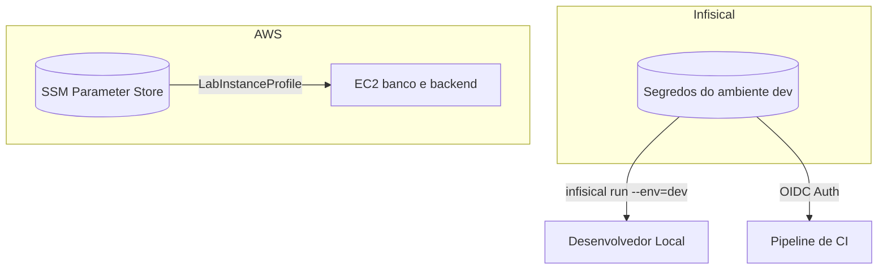

# Segurança e Gerenciamento de Segredos

Este documento descreve a política de segurança, o modelo de proteção e a estratégia de gerenciamento de credenciais e segredos do projeto **CloudOps Lab**.

---

## 1. Princípios de Segurança

1. **Secret Zero no Código:** Nenhuma credencial, senha, token ou chave privada deve ser commitada no Git.
2. **Menor Privilégio (Least Privilege):** Cada serviço, pipeline e usuário deve possuir apenas as permissões estritamente necessárias para sua operação.
3. **Isolamento de Ambientes:** Segredos de desenvolvimento local, homologação e produção devem ser mantidos isolados e com acessos restritos.

---

## 2. Gerenciamento de Segredos (Infisical + SSM Parameter Store)

O projeto adota uma estratégia **híbrida**, separando desenvolvimento/CI de produção:
- **Infisical:** ambiente `dev`, usado no desenvolvimento local e no pipeline de CI.
- **SSM Parameter Store:** produção AWS, lido pelas EC2 durante o deploy.

A decisão e suas justificativas estão registradas na [ADR 006](../arquitetura/adrs/006-estrategia-hibrida-de-segredos.md).

### 2.1. Como Funciona o Fluxo de Segredos



### 2.2. Uso do CLI do Infisical (Desenvolvimento Local)

1. **Login no Infisical:**
   ```bash
   infisical login
   ```
2. **Vincular o Projeto (gera o `.infisical.json`, versionável por não conter segredos):**
   ```bash
   infisical init
   ```
3. **Executar a aplicação injetando os segredos do ambiente `dev`:**
   ```bash
   infisical run --env=dev -- docker compose up --build
   # ou, para um serviço isolado:
   infisical run --env=dev -- npm --prefix backend run dev
   ```

### 2.3. Pipeline de CI (GitHub Actions)

- O workflow de CI utiliza uma **Machine Identity** do Infisical com **OIDC Auth**, sem armazenar credenciais de longa duração no GitHub.
- O job autentica com `Infisical/secrets-action@v1.0.16` e injeta os segredos do ambiente `dev` como variáveis de ambiente para os passos seguintes.
- A identidade deve ter apenas permissão de leitura (**Viewer**) no projeto e os claims OIDC restritos ao repositório/branches permitidos (`main` e `develop`).
- Variáveis não sensíveis usadas pelo workflow (`INFISICAL_IDENTITY_ID` e `INFISICAL_PROJECT_SLUG`) ficam em *Variables* do repositório, não em *Secrets*.
- Em pull requests o passo do Infisical é ignorado; os testes usam os valores sintéticos de ambiente de teste.

### 2.4. Produção AWS (SSM Parameter Store)

- Os segredos de produção ficam no **SSM Parameter Store**, como `SecureString`, e são criados por `infra/deploy/criar-segredos.sh`.
- As EC2 os leem durante o deploy usando o `LabInstanceProfile`; os valores não passam pelo código, pelo GitHub nem pelos logs.
- Essa escolha é deliberada: o AWS Academy Learner Lab não permite criar roles IAM para OIDC com a AWS, e o SSM já é usado para o acesso administrativo via SSM Session Manager ([ADR 005](../arquitetura/adrs/005-acesso-administrativo-via-ssm.md)).
- As credenciais temporárias da AWS usadas pelo workflow de CD ficam em GitHub Secrets e são renovadas a cada sessão do Learner Lab.

---

## 3. Arquivos `.env` e Boas Práticas

- Arquivos `.env` reais estão explicitamente incluídos no `.gitignore`.
- O repositório fornece apenas o arquivo de referência `.env.example`, contendo a lista de variáveis necessárias com valores fictícios. **Não crie um `.env` real**: no desenvolvimento use o Infisical; em produção, o SSM Parameter Store.
- O `docker-compose.yml` falha intencionalmente se `POSTGRES_PASSWORD`, `JWT_ACCESS_SECRET` ou `JWT_REFRESH_SECRET` não forem definidos, evitando subir com credenciais padrão. A `DATABASE_URL` do container é montada a partir de `POSTGRES_USER`, `POSTGRES_PASSWORD` e `POSTGRES_DB`.

---

## 4. Auditoria e Varredura de Código

- Recomenda-se o uso de ferramentas de varredura de segredos (ex: `gitleaks` ou `trufflehog`) em hooks pré-commit ou no pipeline de CI/CD para bloquear commits acidentais contendo credenciais.

